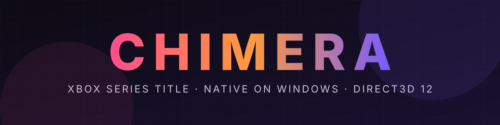

<p align="center">
  
</p>

<p align="center">
  <a href="LICENSE"></a>
  
  
  
  <a href="https://t.me/+rL9uLOqRWck2ZDMx"></a>
</p>

**CHIMERA** runs an Xbox Series title natively on Windows, from files you
supply yourself. It is a fork of
[VIctory](https://github.com/Marvisak/VIctory) by way of
[fxceless/victory-fork](https://github.com/fxceless/victory-fork), with the
Windows 10 and RTX 30-series work of several contributors and a few changes
of its own. The name is the point: it is stitched together from the best
parts of many people's work.

> **This repository contains no game files, keys, code or assets of the title,
> and never links to any.** You need your own copy. CHIMERA is not affiliated
> with or endorsed by the title's developer or publisher, or by Microsoft.
> There is no download of a ready-to-play build — anything offering one is a scam.

---

## Status

Tested on **Windows 10 LTSC 21H2**, **AMD Ryzen 7 2700**, **NVIDIA RTX 3080 Ti 12 GB**, 32 GB RAM, Series X profile.

| Stage | State |
|---|---|
| Boot, first-boot screens, intro, menus | works, 30 fps |
| Saves and settings | work |
| Prologue gameplay | renders and plays; **2–5 fps** depending on the scene |
| Light in shadow | black — the title's ray-traced lighting does not run yet |
| Textures | stream in over the first minutes of a scene; some stay stale |
| Audio | plays; crackles at low frame rates |
| Series S profile | reaches a black screen only |

## What CHIMERA adds on top of victory-fork

- **Windows 10 support** — loads the D3D12 Agility SDK runtime so shader model 6.6 works without Windows 11.
- **Texture mip-drop** under video-memory pressure (port of VIctory #1272), kept alongside upstream's *levels on demand*.
- **Shader translator fixes** — row permutations on wave32 hosts, measured images, f16 interpolation halves, 16-bit wave sums, safer permlane lowering (`VICTORY_PERMLANE`).
- **GPU copy path** — the D3D12 copy queue for relay card-copy fetches, a parallel card compare (`VICTORY_CARD_COMPARE_PARALLEL`), opt-in VRAM scratch through Resizable BAR (`VICTORY_SCRATCH_VRAM`).
- **Fullscreen** — `VICTORY_FULLSCREEN=1` makes the game cover the screen a few seconds after it starts presenting.

## Requirements

- Windows 10 or 11, x64, a CPU with AVX2
- A Direct3D 12 GPU with shader model 6.6 and mesh shaders (NVIDIA RTX 20 series or newer)
- [Rust](https://rustup.rs) — the version is pinned in `rust-toolchain.toml`
- 32 GB RAM recommended; about 24 GB is in use while playing. If `crashes.log` reports Windows error **1455**, enlarge the paging file.

## Build

```powershell
git clone https://github.com/LukaManstein/CHIMERA
cd CHIMERA
cargo build --release -p victory
```

## Play

```powershell
copy victory.example.toml victory.toml   # optional: set your paths (outside the repo)
scripts\play.cmd "D:\path\to\your\dump\<the title's exe>"
```

`scripts\play.cmd` sets the recommended switches, starts the game and writes a
log next to it. **The first minutes are slow**: shaders are translated on first
use and cached for the next run.

Keyboard (when no pad is connected): **WASD** left stick · **IJKL** right stick ·
**arrows** D-pad · **Enter** A · **Backspace** B · **X / Y** · **Q / E** shoulders ·
**Z / C** triggers · **Esc** Menu · **Tab** View. XInput pads work as they are.

### Switches

| Variable | Effect |
|---|---|
| `VICTORY_FULLSCREEN=1` | cover the whole screen (0 = window) |
| `VICTORY_LATE_WAIT=3`, `VICTORY_WIDE_BACK=1` | send work to the GPU ahead of waiting for it — faster frames |
| `VICTORY_CARD_BUFFERS_MIN_MB=1`, `VICTORY_CARD_BUFFERS_MB=1024` | keep title buffers in video memory |
| `VICTORY_TEXTURE_STAGE_MB=384` | upload textures faster after a scene loads (costs frame time while it catches up) |
| `VICTORY_PERMLANE=0` | refuse permlane shaders as before (for comparison) |

Every switch is described in a comment where the code reads it. The full
upstream list, including debugging aids, is in
[docs/victory-fork-README.md](docs/victory-fork-README.md).

## Roadmap

- [ ] Audio without crackles at low frame rates
- [ ] A steady 5 fps in the world on a Ryzen 7 2700-class CPU
- [ ] Compute pipelines the host refuses on Windows 10 (`E_INVALIDARG`)
- [ ] Textures that change after upload without being noticed
- [ ] Ray-traced light and shadows

## Community

News, builds-from-source help and progress videos: **[Telegram](https://t.me/+rL9uLOqRWck2ZDMx)**.
Bugs go to [Issues](https://github.com/LukaManstein/CHIMERA/issues) (use the form).
Never post game files, keys, executables or links to them — anywhere.

## Credits

CHIMERA is mostly other people's work, and proud of it.

- **[VIctory](https://github.com/Marvisak/VIctory)** by **Marvisak** and its contributors — the loader, the runtime services, the Direct3D 12 back end and the shader recompiler. Everything here stands on it.
- **[victory-fork](https://github.com/fxceless/victory-fork)** by **fxceless** and its contributors — the rendering, speed and stability work that takes the title from its menus into the world.
- **[XCL](https://github.com/ivall/xcl)** by **ivall** and contributors — used upstream as a reference for how the title behaves.
- The Windows 10 / RTX 30-series line: **kykifox1337-source** (Agility SDK on Windows 10), **LovettCustoms** (mip-drop, VRAM scratch, toggles, Windows 10 findings), **Noname0202** (copy queue, parallel card compare), **jaschinski97-ops**, **undeadhuman37**, **triippywhale**, **cxccxc** and **oddiums** (shader fixes and tests).
- Fullscreen and the CHIMERA packaging: **LukaManstein**.
- Much of the work in this family of forks was developed with [Claude Code](https://claude.com/claude-code).

Every commit keeps its original author. See `git log` for the full picture.

## License

GPL-3.0-or-later, the same as VIctory — see [LICENSE](LICENSE). If you share a
build, you must share its source under the same license.
